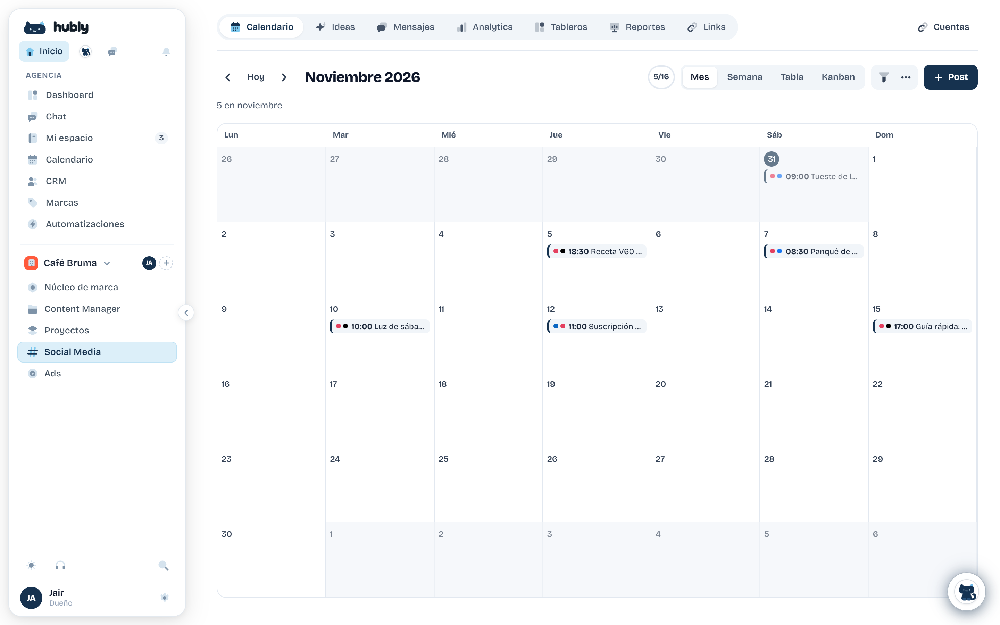
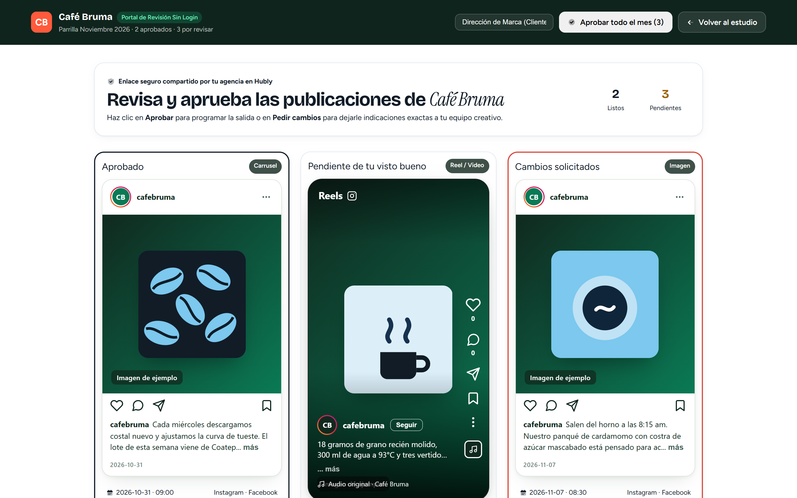

<p align="center">
  
</p>

<p align="center">
  <strong>Plataforma de código abierto para que las agencias de marketing gestionen las redes sociales de todos sus clientes.</strong>
</p>

<p align="center">
  
  <a href="LICENSE"></a>
  <a href="CONTRIBUTING.md"></a>
  <a href="https://github.com/jairbonillacan-cmd/Hubly/stargazers"></a>
</p>

> [!NOTE]
> **Hubly sigue en desarrollo.** Ya funcionan las cuentas, las agencias, el calendario y la aprobación por enlace, pero todavía no se conecta con las redes: nada se publica de forma automática. Sin Supabase, la app corre en modo demo con datos de ejemplo.

## Qué quiere resolver

Las fotos en tres carpetas de Drive, los textos en un documento que nadie encuentra, las aprobaciones perdidas en WhatsApp y los reportes a mano a fin de mes. Hubly reúne ese trabajo para que el equipo se dedique a crear.

<p align="center">
  
</p>

## Qué hay hoy

| | |
|---|---|
| **Cuentas y agencias** | Registro con correo o Google, varias agencias por persona, invitaciones y cuatro roles: propietario, administrador, editor y lector. |
| **Calendario** | Vistas de mes, semana, tabla y Kanban por marca, y un editor con formatos, límites y vista previa de diez redes. |
| **Parrillas** | Publicaciones ordenadas por día, con importación desde CSV, XLSX o una tabla pegada. |
| **Aprobación del cliente** | Revisión por enlace, sin cuenta ni contraseña, con comentarios por publicación. |
| **Archivos** | Biblioteca privada por agencia: imágenes y documentos de hasta 20 MB, videos de hasta 100 MB. |
| **Textos con IA** | Redacción en el editor con el tono, los pilares y las palabras de cada marca. Requiere una clave de Anthropic. |
| **Reportes** | Resultados por marca, a partir de las cifras que el equipo captura en cada publicación. |

<p align="center">
  
</p>

<p align="center">
  
</p>

<p align="center"><em>Capturas del modo demo, con marcas de ejemplo.</em></p>

## Qué falta

| | |
|---|---|
| **Conexión con redes** | Enlazar las cuentas de cada marca y publicar de forma automática. |
| **Reportes automáticos** | Traer las cifras de las cuentas conectadas, sin capturarlas a mano. |
| **Panel de anuncios** | Gasto y resultados por cliente. Hoy solo existe en modo demo. |
| **Asistente con IA** | El chat con cada marca. Hoy solo existe en modo demo. |

## Por qué código abierto

- **Tus datos son tuyos:** alojas Hubly en la infraestructura que elijas.
- **Sin licencia por marca o por persona:** si lo alojas tú, crecer no añade cobros de licencia.
- **Adaptable:** cada agencia puede ajustarlo y extenderlo a su manera.

## Hoja de ruta

- [x] Repositorio, licencia y landing
- [x] Prototipo de la interfaz con datos de ejemplo
- [x] Cuentas, agencias y permisos reales
- [x] Calendario y editor de publicaciones
- [x] Parrillas y aprobación por enlace
- [ ] Conexión con redes y publicación programada
- [ ] Reportes automáticos y panel de anuncios
- [ ] Asistente con la voz de cada marca

El orden puede cambiar según lo que nos cuenten las agencias.

## Ejecutar el proyecto

Necesitas [Node.js](https://nodejs.org) 20.9 o superior.

```bash
cd web
npm install
npm run dev
```

Se abre en [localhost:3000](http://localhost:3000), en modo demo. Para activar el resto, copia `web/.env.example` a `web/.env.local` y define lo que necesites:

| Variable | Para qué sirve |
|---|---|
| `NEXT_PUBLIC_SUPABASE_URL` y `NEXT_PUBLIC_SUPABASE_PUBLISHABLE_KEY` | Cuentas y datos reales. Sigue los pasos de [Conectar Supabase](supabase/README.md). |
| `ANTHROPIC_API_KEY` | Redacción con IA en el editor. |
| `WAITLIST_WEBHOOK_URL` | Guardar los registros de la lista de espera de la landing. |

### Comprobaciones

Se ejecutan en `web/`. Todas menos las pruebas en navegador corren también en cada pull request.

| Comando | Qué comprueba |
|---|---|
| `npm run build` | Que el proyecto compila. |
| `npx tsc --noEmit` | Los tipos. |
| `npm test` | Las pruebas unitarias. |
| `npm run test:db` | Las migraciones y los permisos, en un Postgres local sin Supabase. |
| `npm run check:ui` | Las reglas de la [guía de interfaz](docs/GUIA-UX-UI-AGENTES.md). |
| `npx playwright test` | Los flujos en navegador, con Chrome instalado. |

## Estructura

| Carpeta | Contenido |
|---|---|
| `web/` | Landing y aplicación en Next.js. |
| `supabase/` | Migraciones del esquema y permisos. |
| `docs/` | Guía de interfaz, planes y registros de trabajo. |

## Contribuir

Lo más útil ahora es saber cómo trabaja tu agencia y qué te quita más tiempo: [abre un issue](https://github.com/jairbonillacan-cmd/Hubly/issues/new/choose) o lee la [guía de contribución](CONTRIBUTING.md).

## Licencia

[GNU AGPL-3.0](LICENSE)
