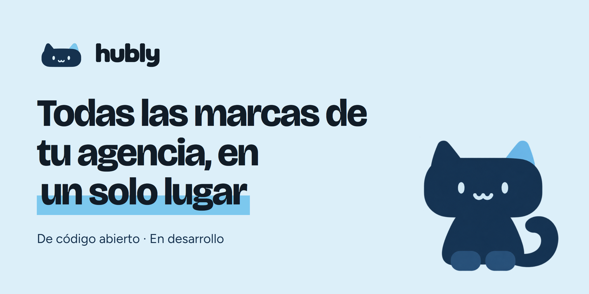

<p align="center">
  
</p>

<p align="center">
  <strong>Plataforma de código abierto para que las agencias de marketing gestionen las redes sociales de todos sus clientes.</strong>
</p>

<p align="center">
  
  <a href="LICENSE"></a>
  <a href="CONTRIBUTING.md"></a>
  <a href="https://github.com/jairbonillacan-cmd/Hubly/stargazers"></a>
</p>

> [!NOTE]
> **Hubly está empezando.** El repositorio contiene la landing y un prototipo de la aplicación con datos de ejemplo: todavía no hay cuentas reales, conexión con redes ni publicación. Las funciones de abajo son lo que queremos construir.

## Qué quiere resolver

Las fotos en tres carpetas de Drive, los textos en un documento que nadie encuentra, las aprobaciones perdidas en WhatsApp y los reportes a mano a fin de mes. Hubly reúne ese trabajo para que el equipo se dedique a crear.

<p align="center">
  
</p>

## Funciones previstas

| | |
|---|---|
| **Programación** | Calendario por marca, con publicación automática en las principales redes. |
| **Parrillas** | Publicaciones ordenadas por día, para compartir por enlace o PDF. |
| **Aprobación del cliente** | Revisión por enlace, sin cuenta ni contraseña, con comentarios por publicación. |
| **Reportes** | Reportes mensuales de redes y anuncios a partir de las cuentas conectadas. |
| **Panel de anuncios** | Gasto y resultados por cliente en las distintas plataformas. |
| **Asistente con IA** | Textos con la voz y las reglas de cada marca. |

## Por qué código abierto

- **Tus datos son tuyos:** alojas Hubly en la infraestructura que elijas.
- **Sin licencia por marca o por persona:** si lo alojas tú, crecer no añade cobros de licencia.
- **Adaptable:** cada agencia puede ajustarlo y extenderlo a su manera.

## Hoja de ruta

- [x] Repositorio, licencia y landing
- [x] Prototipo de la interfaz con datos de ejemplo
- [ ] Cuentas, agencias y permisos reales
- [ ] Calendario y publicación programada
- [ ] Parrillas y aprobación por enlace
- [ ] Reportes y panel de anuncios
- [ ] Asistente con la voz de cada marca

El orden puede cambiar según lo que nos cuenten las agencias.

## Ejecutar el proyecto

Necesitas [Node.js](https://nodejs.org) 20.9 o superior.

```bash
cd web
npm install
npm run dev
```

Se abre en [localhost:3000](http://localhost:3000). Para que la lista de espera guarde registros, copia `web/.env.example` a `web/.env.local` y define `WAITLIST_WEBHOOK_URL`.

## Contribuir

Lo más útil ahora es saber cómo trabaja tu agencia y qué te quita más tiempo: [abre un issue](https://github.com/jairbonillacan-cmd/Hubly/issues/new/choose) o lee la [guía de contribución](CONTRIBUTING.md).

## Licencia

[GNU AGPL-3.0](LICENSE)
