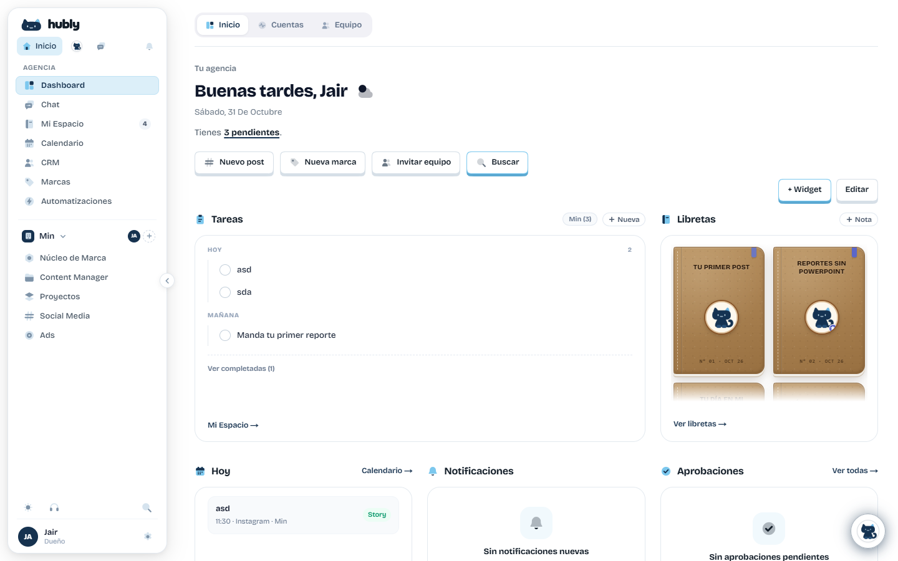
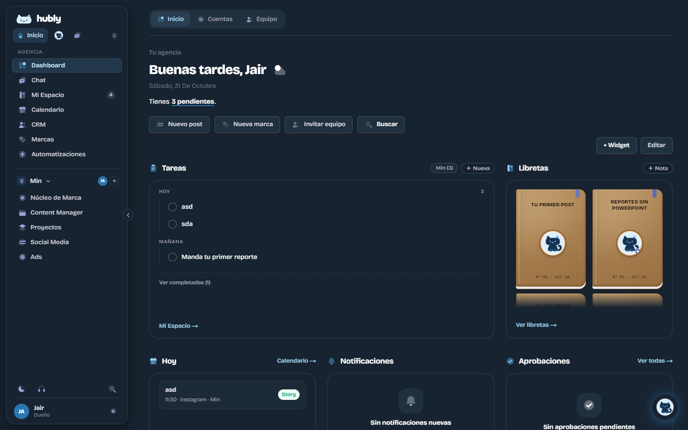
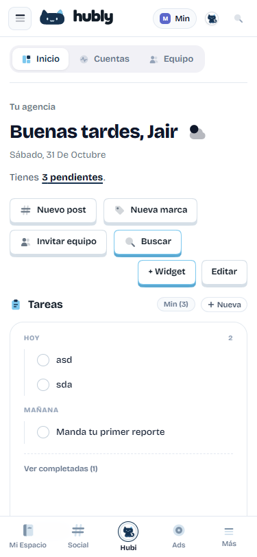
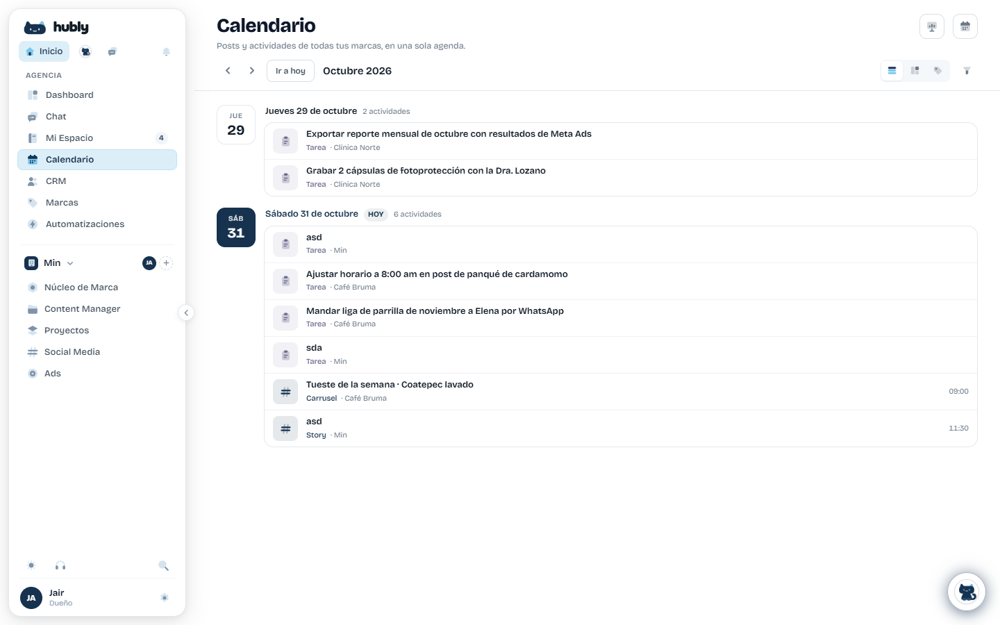
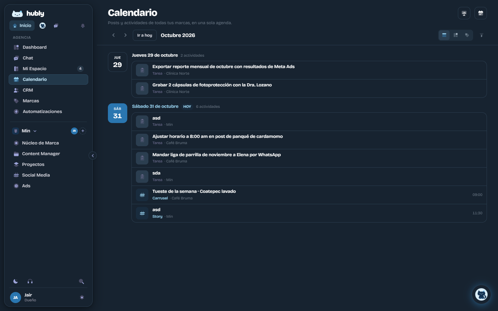
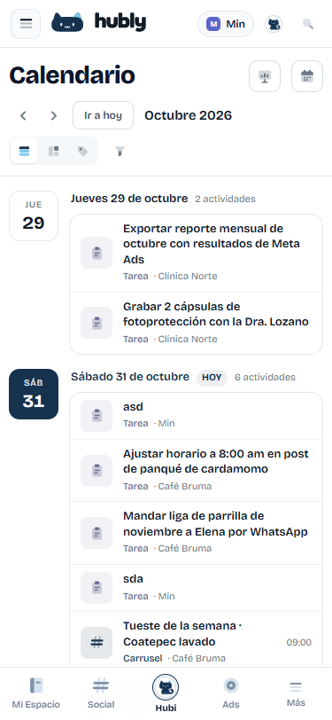
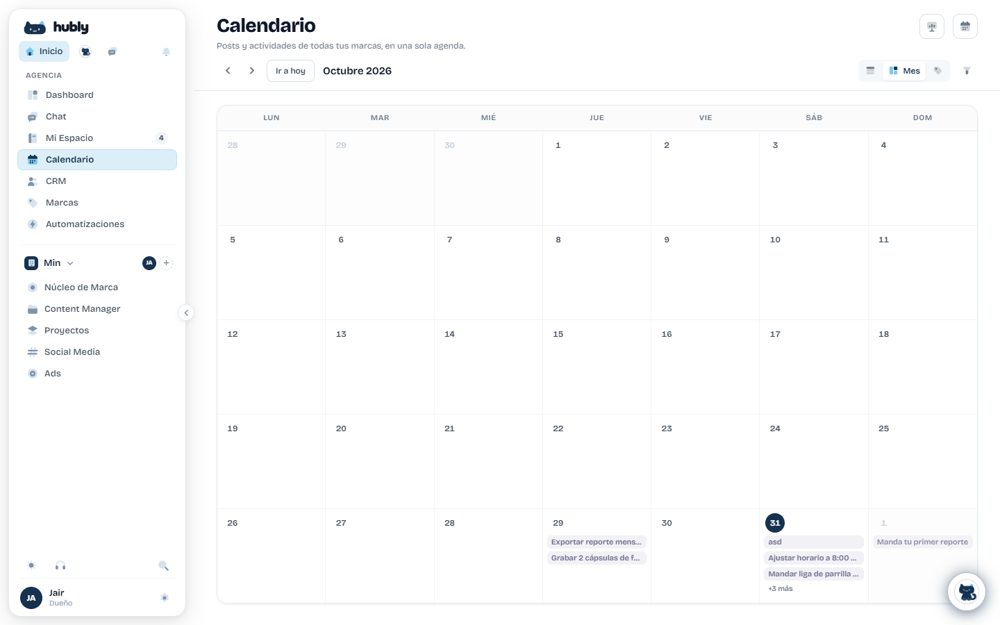

# Guía de UX/UI para agentes

Reglas para cambiar la interfaz de Hubly sin producir *slop*: pantallas genéricas, inconsistentes o decorativas que parecen salidas de una plantilla de IA.

Está escrita para ejecutarse al pie de la letra. **No hace falta tener criterio de diseño para seguirla: hace falta no improvisar.** Si una regla y tu intuición chocan, gana la regla.

Las medidas de esta guía se tomaron del navegador el 31 de octubre de 2026, no solo del CSS. Alcance: la app autenticada. La landing tiene su propia sección ([§18](#18-landing-y-páginas-públicas)).

---

## 0. Cómo trabajar

### Orden de autoridad

Cuando dos fuentes se contradigan, manda la primera:

1. Lo que pidió el usuario en esta tarea.
2. Esta guía.
3. Lo que se ve en `/dashboard` y `/calendario`.
4. `DESIGN.md` (identidad, logo, Hubi) y `PRODUCT.md` (producto, honestidad).
5. Cualquier otra pantalla. **Otras pantallas no son referencia:** muchas arrastran deuda, aunque lleven tiempo ahí.

### Los 8 pasos

Haz todos, en orden.

1. **Lee** esta guía completa y mira las capturas de [§2](#2-las-dos-pantallas-de-referencia).
2. **Clasifica** la pantalla: ¿agenda o tablero? ([§8](#8-plantillas-de-pantalla)).
3. **Abre** en el navegador `/dashboard` y `/calendario`, y la pantalla que vas a cambiar.
4. **Busca antes de crear.** Recorre las recetas de [§9](#9-componentes). Si existe, se usa. No se crea una variante.
5. **Construye** solo con tokens ([§3](#3-color)), escalas ([§4](#4-tipografía), [§5](#5-espacio-radios-y-sombras)) e iconos duotono ([§6](#6-iconos)).
6. **Cubre los estados** de [§10](#10-estados-obligatorios). Una pantalla con solo el caso feliz no está terminada.
7. **Verifica** con [§17](#17-verificación-y-entrega): `npm run check:ui`, escritorio, móvil y modo oscuro.
8. **Entrega** con el formato de [§17](#formato-de-entrega). Di lo que no pudiste comprobar.

### Límites de la tarea

- Cambia solo lo pedido. No «aproveches» para rediseñar lo de al lado.
- Conserva textos, datos y comportamiento salvo que te pidan cambiarlos.
- No añadas funciones, secciones, métricas ni tarjetas que nadie pidió. Es la forma más común de slop.
- No apagues ni reinicies el servidor de desarrollo: el usuario está viendo los cambios en vivo. Si `localhost:3000` ya responde, úsalo.

---

## 1. El ADN de Hubly

Si tu pantalla no cumple estos ocho rasgos, no parece Hubly.

| # | Rasgo | En la práctica |
|---|---|---|
| 1 | **Lienzo blanco y plano** | Fondo `--ui-surface`. La estructura la dan líneas de 1px y espacio, no sombras ni bloques de color. |
| 2 | **Color con cuentagotas** | Casi todo es tinta sobre blanco. Marino y celeste marcan solo lo activo, lo importante o lo de hoy. |
| 3 | **Densidad de herramienta** | El texto de trabajo mide 13–14px. Esto es software para usar ocho horas, no una página de marketing. |
| 4 | **Jerarquía por peso y tamaño** | Un título de 28px, luego títulos de 16px, luego filas de 13px. Nunca con color ni con cajas alrededor. |
| 5 | **Filas, no tarjetas** | Una lista es un contenedor con borde y filas separadas por una línea. No una pila de tarjetas. |
| 6 | **Botón táctil** | `.hbtn` tiene un canto inferior de 4px y se hunde 3px al pulsar. Es la firma de la marca: no se reemplaza por botones planos. |
| 7 | **Iconos duotono propios** | Dos capas rellenas, redondeadas. Nunca trazo fino. |
| 8 | **Quietud** | Movimiento breve (90–200ms), solo como respuesta a una acción. Nada se mueve solo. |

**La prueba rápida:** tapa el logo. Si la pantalla podría ser de cualquier SaaS, faltan rasgos 5, 6 o 7. Si llama la atención antes de que leas el contenido, sobran colores, sombras o decoración.

---

## 2. Las dos pantallas de referencia

Compara tu resultado contra estas imágenes antes de entregar. Si los datos cambiaron no importa: se compara la forma.

| Pantalla | Claro | Oscuro | Móvil |
|---|---|---|---|
| **Tablero** `/dashboard` |  |  |  |
| **Agenda** `/calendario` |  |  |  |
| **Rejilla mensual** |  | | |

Código de referencia:

- Tablero: `web/components/app/dashboard/InicioView.tsx`
- Agenda: `web/app/(app)/calendario/page.tsx`
- Estilos de ambas: `web/app/(app)/dashboard-polish.css` (§3–§5 y §8 del archivo)

### Qué copiar

- La estructura de encabezado, barra de herramientas y cuerpo de `/calendario`.
- La cabecera de widget y el contenedor de 20px de radio de `/dashboard`.
- La fila de agenda: icono de 36px, título, meta y hora alineada a la derecha.
- El indicador de hoy: el único bloque marino sólido de la pantalla.
- Las etiquetas de pestaña que aparecen al pasar el cursor.

### Qué NO copiar, aunque esté en las referencias

Son defectos conocidos. Se corrigen al tocarlos y no se replican.

| Defecto | Dónde | Lo correcto |
|---|---|---|
| Colores lavanda `#6A6A8C`, `#A97FC4`, `#94A3DD` y fondo `#F1F1F6` | `KIND_STYLE` del calendario, badges | Tokens `--ui-*`; `#A97FC4` sobre blanco da 3.22:1 y no alcanza |
| Placeholder `#C3CFDA` (1.58:1) | `.hubly-cal-line` | `--ui-text-4` |
| Mayúsculas de título: «Sábado, 31 De Octubre» | Fecha del hero | «Sábado, 31 de octubre» |
| Pretítulo «Tu agencia» | Hero del dashboard | Es la única excepción. No añadas pretítulos nuevos |
| Etiqueta de `Story` en verde sin ser un estado | Widget Hoy | El verde solo significa un estado correcto |
| Filas con `style={{}}` larguísimos y hex sueltos | Todo `InicioView` | Clases con tokens ([§9](#9-componentes)) |
| Celda del mes clicable sin rol ni teclado | `.hubly-cal-cell` | `button` o `role="button"` con `tabIndex` y `Enter` |
| Modal sin `useLayer` | Modal del calendario | Usa `useLayer` ([§9.9](#99-modal)) |
| `.hbtn-danger` pierde el rojo en modo oscuro | Regla `html.dark .hbtn` de `dashboard-polish.css` | Hasta corregirlo, el texto del botón debe decir la acción sin ambigüedad: «Eliminar marca» |

---

## 3. Color

### Tokens permitidos

Todos cambian solos en modo oscuro. **Usa solo esta tabla.**

| Token | Claro | Oscuro | Úsalo para |
|---|---|---|---|
| `--ui-surface` | `#FFFFFF` | `#15202B` | Fondo de página, contenedores, modales |
| `--ui-surface-2` | `#F8FAFC` | `#1C2A38` | Hover de fila, fondo de cabecera de tabla |
| `--ui-muted` | `#F1F5F9` | `#263747` | Fondo de control inactivo, badge neutro |
| `--ui-border` | `#E2E8F0` | `#2B3E50` | Bordes de contenedor y separadores |
| `--ui-border-strong` | `#CBD5E1` | `#3A5064` | Bordes de inputs y controles |
| `--ui-text` | `#0F172A` | `#ECECF1` | Títulos y texto principal |
| `--ui-text-2` | `#334155` | `#D2D2DB` | Texto de cuerpo |
| `--ui-text-3` | `#475569` | `#BDBDC9` | Texto secundario |
| `--ui-text-4` | `#64748B` | `#A5A5B3` | Meta, fechas, ayudas, placeholder (4.76:1, el mínimo para leer) |
| `--ui-text-5` | `#94A3B8` | `#8F8F9E` | **Solo iconos decorativos o `disabled`. Nunca texto que haya que leer** (2.56:1) |
| `--hb-accent` | `#16324F` | `#2A76B0` | Relleno de acción principal; indicador de hoy |
| `--hb-accent-hover` | `#0F2539` | `#3487C4` | Hover del relleno anterior |
| `--hb-accent-text` | `#16324F` | `#9AD4F1` | Texto o icono de acento; enlaces de widget |
| `rgb(var(--hb-accent-rgb) / 0.08)` | | | Tinte de acento: alfa 0.08 en reposo, 0.14 en énfasis |
| `--on-accent` | `#FFFFFF` | `#FFFFFF` | Texto sobre `--hb-accent` |
| `--ui-sky` | `#7CC8EE` | `#7CC8EE` | Borde del botón destacado. **Nunca como fondo de texto blanco** (1.85:1) |
| `--ui-sky-soft` | `#DCEFF9` | `#22384A` | Fondo del ítem activo en navegación |
| `--ui-sky-text` | `#16324F` | `#BFE2F4` | Texto sobre `--ui-sky-soft` |
| `--ui-sky-border` | `#BFE2F4` | `#2F4C63` | Borde del ítem activo |

### Colores de estado

Solo significan estado. No decoran.

- Estados de un post: se leen de `STATUS_META` en `web/components/app/social/status-meta.ts`. No inventes otros.
- Error o acción destructiva: `.hbtn-danger` para botones, y `STATUS_META.changes` como referencia de color.
- Correcto: el verde de `STATUS_META.approved`.

### Reglas

1. Ningún color fijo en código nuevo: nada de `#xxxxxx`, `rgb(12,…)` ni clases como `bg-blue-500`. `npm run check:ui` lo detecta.
2. El marino nunca se escribe como `#16324F`: en oscuro no se distingue del fondo. Usa `--hb-accent` o `--hb-accent-text`.
3. Como máximo **un** bloque de acento sólido visible por grupo. En `/calendario` es solo el día de hoy.
4. El color de una marca cliente (`brand.color`) aparece solo en su punto o avatar, nunca como fondo de una sección.
5. Si algo necesita destacar, primero prueba con peso o tamaño. Color, solo si eso no basta.

### Tokens prohibidos

Existen por motivos históricos. No los uses en código nuevo aunque los veas al lado:

- Nombres engañosos: `--green*`, `--yellow*`, `--lilac*`, `--cream`, `--forest`, `--hubly-amber*`, `--hubly-indigo*`, `--hb-indigo*`, `--hb-amber*`, `--accent-dark`, `--hg-elegido`.
- Familias paralelas: `--text-*`, `--bg-*`, `--border-*`, `--hb-text*`, `--hb-border*`, `--hubly-text-*`.
- Variantes de botón: `.hbtn-blue`, `.hbtn-pink`, `.hbtn-purple`, `.hbtn-amber`, `.hbtn-hb`, `.saas-btn*`.

Si falta un token, **no lo inventes:** usa el más cercano de la tabla y avísalo en la entrega.

---

## 4. Tipografía

Una sola familia en toda la app: **Bricolage Grotesque**, ya aplicada por herencia. No declares `font-family`. No uses mono, serif ni Figtree dentro de la app.

Para cifras alineadas usa `font-variant-numeric: tabular-nums`, no otra fuente.

| Rol | Tamaño | Peso | Tracking | Color | Ejemplo real |
|---|---:|---:|---:|---|---|
| Título de pantalla (`h1`, uno por pantalla) | 28px | 800 | -0.02em | `--ui-text` | «Calendario» |
| Título de modal | 18px | 700 | | `--ui-text` | «Nueva actividad» |
| Título de widget o sección | 16px | 700 | -0.01em | `--ui-text` | «Tareas» |
| Periodo o subtítulo fuerte | 15px | 600 | | `--ui-text` | «Octubre 2026» |
| Cuerpo | 14px | 400 | | `--ui-text-2` | «Tienes 3 pendientes» |
| Título de fila, input | 13–13.5px | 500–600 | | `--ui-text` | Título de una tarea |
| Botón | 13px | 600 | | según variante | «Nuevo post» |
| Secundario | 12.5px | 400–600 | | `--ui-text-4` | Descripción de pantalla |
| Botón pequeño, enlace de widget | 12–12.5px | 600 | | `--hb-accent-text` | «Calendario →» |
| Meta | 11px | 400–500 | | `--ui-text-4` | «Tarea · Clínica Norte» |
| Rótulo en mayúsculas | 10.5–11px | 600 | 0.06em | `--ui-text-4` | «HOY», «LUN» |

Escala completa: **10, 10.5, 11, 11.5, 12, 12.5, 13, 13.5, 14, 15, 16, 18, 20, 28**. Ningún otro valor. No añadas tamaños «intermedios».

Reglas:

1. Mayúsculas sostenidas solo en rótulos de hasta dos palabras (día de la semana, grupo, etiqueta de campo). Jamás en títulos, botones o frases.
2. Títulos y botones en mayúscula inicial solamente: «Nueva marca», no «Nueva Marca».
3. Peso 800 solo en el `h1`. Por debajo de 11px nunca hay texto que haya que leer.
4. Máximo tres tamaños distintos dentro de un mismo componente.

---

## 5. Espacio, radios y sombras

### Espacio

Escala: **2, 4, 6, 8, 10, 12, 14, 16, 20, 24, 32** px.

| Situación | Valor |
|---|---|
| Icono y texto dentro de un control | 6–9 |
| Entre botones | 8–10 |
| Interior de fila | 8 vertical, 12 horizontal |
| Interior de widget | 16–18 vertical, 20 horizontal |
| Interior de modal | 24 (18 abajo) |
| Título de widget a su contenedor | 10 |
| Entre columnas de widgets | 24 |
| Entre filas de widgets | 32 |
| Entre grupos de la agenda | 16 |
| Margen lateral de pantalla, escritorio | 32 |
| Margen lateral de pantalla, móvil | 12–16 |

Regla: lo relacionado va cerca y lo distinto lejos. Si dos bloques tienen el mismo espacio arriba y abajo, la jerarquía se pierde.

### Radios

| Elemento | Radio |
|---|---|
| Chip, pestaña interna, casilla | 6 |
| Control de 32–34px, celda, botón de icono | 8 |
| Input de 40px, botón pequeño | 10 |
| Botón `.hbtn`, tarjeta de día | 12 |
| Lista de filas, contenedor de pestañas, dropdown | 14 |
| Rejilla mensual | 16 |
| Sidebar | 18 |
| Widget | 20 |
| Modal | 24 |
| Pastilla, avatar, punto | 999 |

Regla: un elemento interior siempre tiene radio menor que su contenedor.

### Sombras

Por defecto, **ninguna**. Se separa con borde de 1px.

| Elemento | Sombra |
|---|---|
| Widget, lista, fila | Ninguna |
| Pestaña activa | La de `.hubly-cal-tab[aria-selected="true"]` |
| Botón | El canto de `.hbtn`, ya incluido |
| Dropdown | La de `.hubly-cal-filters` |
| Modal | La de `.hubly-cal-modal` |
| Sidebar y botón flotante de Hubi | Ya definidas |

No añadas sombras a nada más. Nada de `shadow-lg` en tarjetas, resplandores de color ni `hover` que eleve una tarjeta.

### Capas

Usa estos valores, no números inventados: encabezado fijo 20, dropdown 40, botón flotante 45, cajón 50, toast 90, modal 110, confirmación 200.

---

## 6. Iconos

Fuente única: `web/components/app/icons/DuotoneIcons.tsx` (91 iconos).

```tsx
import { HublyCalendarIcon, HublyPlusIcon } from "@/components/app/icons/DuotoneIcons";
```

Disponibles, entre otros: `Home`, `Bento`, `Chat`, `Notebook`, `Calendar`, `Folder`, `Layers`, `Hash`, `Clipboard`, `Bell`, `People`, `Tag`, `Bolt`, `Image`, `Chart`, `Document`, `Upload`, `Spark`, `Link`, `Search`, `Mail`, `Megaphone`, `Settings`, `Shield`, `Lock`, `Clock`, `Info`, `CheckCircle`, `Plus`, `Minus`, `Close`, `Check`, `ChevronLeft/Right/Up/Down`, `ArrowLeft/Right/Up/Down`, `Copy`, `Pencil`, `Trash`, `Send`, `Eye`, `EyeOff`, `Sliders`, `Filter`, `External`, `More`, `Refresh`, `Menu`. El nombre real siempre es `Hubly<Nombre>Icon`.

| Contexto | Tamaño |
|---|---|
| Chevrons y cerrar pequeños | 14–15 |
| Pestañas y barra de herramientas | 15–18 |
| Título de widget y botones | 17–18 |
| Icono de fila | 17 dentro de una caja de 36 |
| Tarjeta de opción | 22 |

Reglas:

1. Nada de `lucide-react` en código nuevo, ni emojis, ni SVG de trazo fino copiados de internet.
2. Si falta un icono, dibújalo en ese archivo con `createDuotoneIcon`: dos capas rellenas en rejilla de 24px, con `SOFT` para la base y `STRONG` para el detalle.
3. Sin colores fijos: heredan de `color`, o se ajustan con `--hi-soft` y `--hi-strong`.
4. Un icono sin texto al lado lleva `aria-label` y `title`.
5. Un icono por concepto: `Hash` es post, `Clipboard` es tarea. No cambies el significado de uno que ya se usa.
6. No todo necesita icono. Los títulos de widget y la navegación sí; las filas de una tabla, los párrafos y las opciones de un menú simple, no.
7. Excepciones: logos de terceros en `components/previews/SocialIcons.tsx` y las letras del editor de texto.

Logo: siempre `HublyBrandLogo`. Hubi: sobre blanco o celeste pálido, nunca directamente sobre marino. Ver `DESIGN.md`.

---

## 7. Movimiento

Solo existe para confirmar una acción o mantener la orientación. Si al quitarlo no se pierde información, sobra.

| Acción | Duración | Curva |
|---|---|---|
| Pulsar botón | 90ms | `cubic-bezier(0.4, 0, 0.2, 1)` |
| Hover de color o fondo | 150ms | `cubic-bezier(0.4, 0, 0.2, 1)` |
| Abrir dropdown | 120ms | `cubic-bezier(0.16, 1, 0.3, 1)` |
| Cerrar dropdown | 100ms | `cubic-bezier(0.4, 0, 1, 1)` |
| Velo de modal, entrar o salir | 150ms | `.hubly-overlay` |
| Abrir modal | 180ms | `.hubly-sheet` |
| Cerrar modal | 150ms | `.hubly-sheet[data-state="closing"]` |
| Sidebar | 200ms | Ya definida |

Reglas:

1. Máximo 200ms en la interfaz de trabajo. La única excepción es el modal de nuevo post (`DESIGN.md`).
2. Anima solo `opacity`, `transform`, `background-color`, `border-color`, `color` o `box-shadow`. Nunca `transition: all`, ni `width`, `height` o `top` salvo un patrón ya existente.
3. Sin animaciones de entrada al cargar, sin escalonados, sin rebotes, sin parallax, sin pulsos ni brillos continuos, sin contadores que suben.
4. Toda animación nueva se anula bajo `@media (prefers-reduced-motion: reduce)`.
5. Para retrasar el desmontaje al cerrar usa `useModalPresence`, no `setTimeout`.

---

## 8. Plantillas de pantalla

Elige una. **No inventes una tercera** sin que te lo pidan.

| Si la pantalla… | Plantilla |
|---|---|
| Muestra una colección para trabajarla (posts, tareas, clientes, archivos, reportes) | **A. Agenda** |
| Resume varias áreas y dirige a cada una | **B. Tablero** |
| Es un formulario o ajuste breve | **Modal** ([§9.9](#99-modal)) |
| Es un formulario largo o ajustes | **A**, con un contenedor de filas por grupo |

La mayoría de las pantallas nuevas son **A**.

### Armazón común

Ya lo dibuja `web/app/(app)/layout.tsx`. No lo reconstruyas:

- Sidebar flotante: 256px, a 12px del borde (68px colapsado). Termina en 268; el contenido empieza en 280.
- Contenido con margen lateral de 32px, y scroll solo dentro del área principal.
- Por debajo de 768px: sin sidebar visible, barra superior y barra de pestañas inferior.
- Botón flotante de Hubi abajo a la derecha: deja libre esa esquina.

### Plantilla A: Agenda

Referencia: `/calendario`.

```tsx
<div className="hubly-cal">
  <header className="hubly-cal-header">
    <div className="hubly-cal-title-row">
      <div>
        <h1 className="hubly-cal-title">Clientes</h1>
        <p className="hubly-cal-subtitle">Quiénes son y qué tienen pendiente.</p>
      </div>
      <button type="button" className="hubly-cal-reveal" title="Nuevo cliente" onClick={onNew}>
        <HublyPlusIcon size={18} />
        <span>Nuevo</span>
      </button>
    </div>
    <div className="hubly-cal-toolbar">
      {/* Navegación a la izquierda; un espaciador flex:1; vistas y filtros a la derecha */}
    </div>
  </header>

  <div className="hubly-cal-body">
    <div className="hubly-cal-agenda">
      <div className="hubly-cal-rows">
        <div className="hubly-cal-row" role="button" tabIndex={0} onClick={onOpen}
             onKeyDown={(e) => { if (e.key === "Enter") onOpen(); }}>
          <span className="hubly-cal-row-icon hubly-lista-icono"><HublyPeopleIcon size={17} /></span>
          <div className="hubly-lista-texto">
            <div className="hubly-cal-row-title">Café Bruma</div>
            <div className="hubly-cal-row-meta"><span>Activo</span><span>· 12 posts</span></div>
          </div>
          <span className="hubly-cal-row-time">09:00</span>
        </div>
      </div>
    </div>
  </div>
</div>
```

```css
.hubly-lista-icono { background: var(--ui-muted); color: var(--ui-text-3); }
.hubly-lista-texto { flex: 1; min-width: 0; }
```

Reglas de A:

1. Un solo `h1`, y una sola línea de descripción de 12.5px que diga algo útil. Si no aporta, se quita.
2. Acciones de pantalla arriba a la derecha, máximo dos.
3. La barra de herramientas va en una sola línea: navegación, espaciador, vistas, filtros.
4. Agrupa por algo con sentido (día, estado), con cabecera de 13px y contador de 11px.
5. Filas a todo el ancho. Dentro: icono, título, meta, y un único dato a la derecha.
6. Sin tarjetas de métricas encima de la lista, salvo que las hayan pedido.

### Plantilla B: Tablero

Referencia: `/dashboard`.

```tsx
<div className="hubly-tablero-grid">
  <section className="hb-widget is-span-2">
    <div className="hb-widget-head">
      <div className="hb-widget-title">
        <span className="hb-widget-icon-box"><HublyClipboardIcon size={18} /></span>
        <span>Tareas</span>
      </div>
      <Link href="/tareas" className="hb-widget-link">Ver todas →</Link>
    </div>
    <div className="hb-widget-body hubly-widget-pad">{/* contenido */}</div>
  </section>
</div>
```

```css
.hubly-widget-pad { padding: 16px 20px; }
```

Reglas de B:

1. El título vive **fuera** del contenedor, encima. El contenedor no lleva cabecera propia. Es el rasgo que distingue estos widgets de los de cualquier dashboard.
2. Rejilla: 3 columnas desde 1280px, 2 desde 768px, 1 en móvil. Se ensancha con `.is-span-2` o `.is-span-3`, no con anchos manuales.
3. Máximo un enlace y una acción en cada cabecera.
4. Cada widget lleva a un lugar: enlace «Ver todas →» o «Calendario →».
5. Sin widgets de relleno. Solo datos reales, o etiquetados como ejemplo.

---

## 9. Componentes

**Cada receta se usa tal cual.** Si vas a crear un componente que se parece a uno de estos, detente.

### 9.1 Elegir el control

| Necesito… | Uso |
|---|---|
| La acción principal de un modal o formulario | `.hbtn .hbtn-primary` |
| Una acción normal | `.hbtn .hbtn-secondary` |
| Una acción sin peso (Cancelar) | `.hbtn .hbtn-ghost` |
| Destacar una acción en una fila de botones blancos | `.hbtn .hbtn-gold`, una por grupo |
| Eliminar | `.hbtn .hbtn-danger` y confirmación con `askConfirm` |
| Icono en encabezado, con etiqueta al hover | `.hubly-cal-reveal` |
| Icono en barra de herramientas | `.hubly-cal-icon` |
| Cerrar | `.hubly-cal-modal-close` |
| Ir a otra pantalla | `.hb-widget-link` o `<Link>` |
| Cambiar de vista con iconos | `.hubly-cal-tabs` |
| Cambiar de sección con texto | `.hubly-subnav-tab` dentro de `.hubly-dashboard-subnav-wrap` |
| Elegir una entre 2–3 opciones visibles | `.hubly-cal-types` |
| Filtrar con opciones múltiples | `.hubly-cal-pill` |
| Elegir entre muchas opciones | `<select>` o `.hubly-cal-brand-option` en dropdown |

### 9.2 Botón

```tsx
<button type="button" className="hbtn hbtn-secondary">
  <HublyPlusIcon size={17} /> Nueva marca
</button>
```

- Tamaños: `hbtn` 36px (por defecto), `hbtn-sm` 30px, `hbtn-lg` 44px, `hbtn-xs` 24px. Solo icono: añade `hbtn-ic`.
- **Una sola** `hbtn-primary` por zona. La mayoría de pantallas no necesita ninguna fuera de un modal: fíjate en que el hero de `/dashboard` no tiene botones marinos.
- Texto: verbo + objeto, de una a tres palabras.
- `disabled` o `aria-disabled="true"` ya están resueltos.
- Nunca reescribas la altura, el radio ni la sombra de un `.hbtn`.

### 9.3 Pestañas de vista

```tsx
<div className="hubly-cal-tabs" role="tablist" aria-label="Vista">
  <button type="button" role="tab" aria-selected={view === "mes"} aria-label="Mes" title="Mes"
          className="hubly-cal-tab" onClick={() => setView("mes")}>
    <HublyBentoIcon size={15} />
    <span>Mes</span>
  </button>
</div>
```

### 9.4 Campo de formulario

```tsx
<label className="hubly-cal-field">
  <span>Título</span>
  <input className="hubly-cal-line" required placeholder="Ej. Grabación con cliente" />
  <small>Lo verá el cliente en su parrilla.</small>
</label>
```

- Todo campo tiene etiqueta visible; el placeholder da un ejemplo y no sustituye a la etiqueta.
- Alto 40px en modales. Para buscar dentro de un filtro: `.hubly-cal-input`, 34px.
- El error va debajo del campo, en texto, con `aria-invalid` y `aria-describedby`.
- Formularios de dos columnas: `.hubly-cal-modal-fields`, solo para datos cortos y emparentados.

### 9.5 Fila de lista

Ver plantilla A. Una fila clicable necesita `role="button"`, `tabIndex={0}` y manejo de `Enter`. Si es un enlace, usa `<Link>`.

Variante de tarea: `.hubly-task-row`, `.hubly-check`, `.hubly-task-title`.

### 9.6 Etiquetas y contadores

| Necesito | Uso |
|---|---|
| Contador junto a un título | `.hb-widget-badge` |
| Estado de un post | Pastilla con los colores de `STATUS_META`, radio 999, 11px, peso 600 |
| «Hoy» | `.hubly-cal-day-head em` |
| Filtro activo | `.hubly-cal-filter-dot` |
| Más elementos | `.hubly-cal-more`: «+3 más» |

Un estado no depende solo del color: siempre lleva su texto.

### 9.7 Fechas y calendario

- Tarjeta de día: `.hubly-cal-date`, añadiendo `.is-today` solo a hoy.
- Celda de mes: `.hubly-cal-cell`, y `.is-outside` fuera del mes.
- Máximo tres chips por celda; el resto se resume con `.hubly-cal-more`.
- Formato: «Sábado 31 de octubre», «Octubre 2026», «09:00». Cifras con `tabular-nums`.
- Fechas siempre con los ayudantes de `lib/date.ts`, y días de semana en orden Lun–Dom.

### 9.8 Estado vacío

Para widgets:

```tsx
<div className="hb-widget-body hb-widget-empty">
  <div className="hb-empty-illus"><HublyBellIcon size={22} /></div>
  <div className="hb-empty-title">Sin notificaciones nuevas</div>
  <p className="hb-empty-desc">Aquí verás comentarios y aprobaciones de tus clientes.</p>
</div>
```

Para pantallas: `.hubly-cal-empty`, con `<strong>` y una línea de texto.

Título: «Sin + objeto». Descripción: qué aparecerá aquí, o qué hacer para que aparezca. Si hay una acción natural, añade un solo botón. Sin ilustraciones grandes ni Hubi nuevo: el vacío también es discreto.

### 9.9 Modal

```tsx
const presence = useModalPresence(open);
useLayer(open, close);

{presence.mounted && (
  <div className="hubly-overlay hubly-cal-overlay" data-state={presence.state}
       onMouseDown={(e) => { if (e.target === e.currentTarget) close(); }}>
    <form className="hubly-sheet hubly-cal-modal" data-state={presence.state}
          role="dialog" aria-modal="true" aria-label="Nueva actividad" onSubmit={save}>
      <div className="hubly-cal-modal-head">
        <h2>Nueva actividad</h2>
        <button type="button" className="hubly-cal-modal-close" aria-label="Cerrar" onClick={close}>
          <HublyCloseIcon size={14} />
        </button>
      </div>
      <div className="hubly-cal-modal-scroll">{/* campos */}</div>
      <div className="hubly-cal-modal-actions">
        <button type="button" className="hbtn hbtn-ghost" onClick={close}>Cancelar</button>
        <button type="submit" className="hbtn hbtn-primary">Guardar</button>
      </div>
    </form>
  </div>
)}
```

`useLayer` da Escape y devuelve el foco a quien abrió. El primer campo lleva `autoFocus`. Ancho máximo 480px, ya definido. En móvil, `.hubly-sheet` ya se convierte en hoja inferior. Nunca abras un modal desde otro.

### 9.10 Confirmación y aviso

```tsx
import { askConfirm, askText } from "@/components/app/AppDialogHost";

if (await askConfirm("¿Eliminar «Café Bruma»?")) eliminar();
const nombre = await askText("Nombre de la carpeta");
```

Nunca `alert`, `confirm` ni `prompt`. Si la acción se puede deshacer, no preguntes: hazla y ofrece deshacer con `.hubly-undo-toast`.

```tsx
<div className="hubly-undo-toast" role="status">
  Tarea eliminada <button type="button" onClick={undo}>Deshacer</button>
</div>
```

### 9.11 Dropdown

Contenedor `.hubly-dropdown`, con `useModalPresence(open, 100)` y `data-state`. El botón que lo abre lleva `aria-expanded`. Ejemplo completo en los filtros de `/calendario`. Cierra con Escape y al hacer clic fuera.

### 9.12 Clases nuevas

Solo si ninguna receta sirve. En ese caso:

1. Decláralas al final de `web/app/(app)/dashboard-polish.css`, con el prefijo `hubly-`.
2. Usa solo tokens y las escalas de esta guía: así funcionan en oscuro sin más trabajo.
3. Usa `style={{}}` solo para un valor realmente dinámico, como el color de una marca. Nunca para maquetar.
4. Extrae un componente a partir del tercer uso, no antes.

---

## 10. Estados obligatorios

Cada vista con datos debe resolver todos estos. Compruébalos uno por uno.

| Estado | Qué mostrar |
|---|---|
| **Cargando** | «Cargando…» en texto discreto, o la estructura sin datos. Sin spinners a pantalla completa ni esqueletos brillantes |
| **Vacío** | Receta 9.8 |
| **Vacío por filtro** | «Sin resultados con estos filtros» y una forma de limpiarlos |
| **Error** | Qué pasó y cómo seguir, con «Reintentar». Conserva lo que el usuario escribió |
| **Con datos** | El caso normal |
| **Mucho contenido** | Un título de 200 caracteres, 100 filas, 40 marcas. Los títulos largos se ajustan o truncan con `title` y nada se desborda |
| **Sin permiso o no disponible** | Con cuentas reales y sin dato real: `LiveUnavailable`. Nunca cifras de ejemplo como si fueran reales |
| **Guardando** | Botón desactivado y su texto en gerundio: «Guardando…». Autoguardado: `SaveStatus` |

Y en cada control: reposo, hover, foco de teclado, pulsado, desactivado.

---

## 11. Modo oscuro

- Se activa con `html.dark`. **No uses `dark:` de Tailwind ni `prefers-color-scheme`.**
- Usando solo los tokens de [§3](#3-color) no hay nada más que hacer. Si necesitas una regla `html.dark` propia, probablemente usaste un color fijo.
- Comprueba con `localStorage.setItem("hubly-theme", "dark")` y recargando.
- Mira especialmente: iconos invisibles, bordes que desaparecen, marino sobre fondo oscuro y blanco fijo en tarjetas.
- Acceso y landing se ven siempre en claro.

---

## 12. Móvil

Puntos de corte: **767.98px** (móvil), 640px (hojas de modal), 1280px (tercera columna del tablero). No añadas otros sin motivo.

1. Sin desbordamiento horizontal en 375px, salvo rejillas o tablas que hagan scroll dentro de su contenedor.
2. Objetivos táctiles de al menos 44×44px en móvil. Los controles de escritorio de 28–32px se amplían con el área pulsable o con `min-height` dentro de la media query.
3. Nada puede depender de `hover`: lo que se revela al pasar el cursor también tiene que estar accesible con un toque.
4. Las filas conservan su estructura; el título pasa a varias líneas.
5. Las tablas anchas hacen scroll dentro de su contenedor o se apilan como filas.
6. Deja hueco para la barra de pestañas inferior: el cuerpo ya usa 100px de margen en `.hubly-cal-body`.

---

## 13. Accesibilidad

Es parte de la definición de terminado:

1. Elemento semántico correcto: `button` para acciones, `a`/`Link` para navegar, `h1`–`h3` sin saltos. Un `div` clicable es la última opción y necesita rol, `tabIndex` y teclado.
2. Contraste de 4.5:1 en texto, 3:1 en iconos que transmiten información.
3. Foco visible siempre. Nunca `outline: none` sin reemplazo. El anillo estándar es `2px solid var(--hb-accent)` con `outline-offset: 2px`.
4. Todo botón de solo icono lleva `aria-label`.
5. Pestañas con `role="tab"` y `aria-selected`; interruptores con `aria-pressed`; menús con `aria-expanded`.
6. Modales con `role="dialog"`, `aria-modal` y `useLayer`.
7. Avisos dinámicos con `role="status"`.
8. Respeta `prefers-reduced-motion`.

---

## 14. Textos

Español de México, tuteando. Directo y cercano.

| Regla | Mal | Bien |
|---|---|---|
| Sin exclamaciones | ¡Enlace copiado! | Enlace copiado |
| Verbo + objeto | Enviar ahora mismo | Enviar a cliente |
| Lenguaje de agencia | Entidades | Marcas |
| Errores útiles | Algo salió mal | No pudimos guardar. Revisa tu conexión e inténtalo otra vez. |
| Vacíos útiles | No hay datos | Sin aprobaciones pendientes |
| Mayúscula inicial solamente | Nuevo Post | Nuevo post |
| Sin marketing en la app | Potencia tu flujo de trabajo | Programa tus posts |
| Sin relleno | Aquí puedes gestionar todos tus clientes de forma fácil | Quiénes son y qué tienen pendiente |

- Vocabulario fijo: post, parrilla, marca, cliente, tarea, libreta, aprobación, reporte. No uses «contenido», «publicación» o «campaña» como sinónimos si la pantalla ya dice otra cosa.
- Comillas angulares: «así». Puntos suspensivos con el carácter `…`.
- **Honestidad (de `PRODUCT.md`):** lo que no existe lleva «Función prevista»; lo inventado, «Datos de ejemplo». Nunca inventes clientes, cifras, testimonios ni logos.
- No nombres competidores ni copies textos de otros productos.
- Datos de ejemplo realistas y del sector: «Café Bruma», «Clínica Norte», nunca «Lorem ipsum», «Usuario 1» o «Acme».
- Lo escrito por el usuario se muestra tal cual, incluso «asd».

---

## 15. Lista de slop

Si tu cambio contiene algo de la columna izquierda, **no está terminado.**

| Slop | Haz esto |
|---|---|
| Fila de cuatro tarjetas de métricas con icono de color | Quítala. Si la pidieron, una línea de texto o una tabla sobria |
| Tarjeta dentro de tarjeta | Un solo contenedor; divide con líneas o espacio |
| Pila de tarjetas con sombra | Contenedor con filas |
| Sombras grandes, resplandores, elevación al pasar el cursor | Borde de 1px |
| Degradados en fondos, botones o texto | Color plano del token |
| Glassmorphism o `backdrop-filter` | Superficie sólida. Solo existe en el velo de modal |
| Morado, índigo, rosa o naranja «para dar vida» | Marino, celeste y grises |
| Cada sección de un color distinto | Lienzo blanco |
| Cuadritos de color pastel detrás de cada icono | Icono duotono solo, o la caja neutra de 36px de la fila |
| Borde izquierdo de color en tarjetas o avisos | Texto más icono |
| Emojis como iconos | Duotono |
| Iconos de trazo fino | Duotono |
| Pretítulo en mayúsculas sobre un título | Solo el título |
| Hero centrado con título gigante en una pantalla de trabajo | Título de 28px a la izquierda |
| Pastillas o badges por todas partes | Texto de meta; badge solo para estado o contador |
| Texto gris sobre gris | `--ui-text-4` como mínimo |
| Botones marinos en cada fila | Secundario o de icono; acciones de fila solo al hover o en menú |
| Todo centrado | Alineado a la izquierda; centrado solo en vacíos |
| Animaciones de entrada, contadores o pulsos | Quítalas |
| Skeletons brillantes o spinners gigantes | Texto discreto |
| Datos inventados, porcentajes o gráficos decorativos | Datos reales o quitarlo |
| Texto de relleno o frases motivacionales | Quítalo |
| Tooltip que explica lo evidente | Quítalo |
| Un control a medida que imita a uno de [§9](#9-componentes) | La receta |
| `!important`, `z-index: 9999`, márgenes negativos para cuadrar | Arregla la causa |
| Valores «casi iguales»: 15px de radio, 13.2px de texto, 7px de espacio | La escala |

---

## 16. Si no sabes qué hacer

| Duda | Decisión |
|---|---|
| ¿Tarjeta o fila? | Fila |
| ¿Sombra o borde? | Borde |
| ¿Con color o sin color? | Sin color |
| ¿Otro botón primario? | No. Secundario |
| ¿Añado un icono? | Solo si nombra una sección o acción, o si el botón no lleva texto |
| ¿Añado una animación? | No |
| ¿Componente nuevo? | No. Busca otra vez en [§9](#9-componentes) |
| ¿Modal o pantalla? | Modal si cabe en una vista y son menos de 6 campos |
| ¿Tamaño intermedio? | El inmediato inferior de la escala |
| ¿Me piden algo que contradice la guía? | Lo pedido gana. Hazlo y señala en la entrega qué regla se cruza |
| ¿No encuentro el token o la receta? | Usa lo más cercano, no inventes, y dilo en la entrega |
| ¿Hay dos formas igual de válidas? | La de `/calendario` |
| ¿Cómo lo hace otra pantalla? | No importa. Solo cuentan `/dashboard` y `/calendario` |
| ¿Sigo puliendo? | No. Una ronda de verificación, una de arreglos, y se entrega |

---

## 17. Verificación y entrega

### Comandos

Desde `web/`:

```bash
npm run check:ui
```

```bash
npx tsc --noEmit
```

```bash
npm test
```

`check:ui` compara contra `web/scripts/check-ui-baseline.json`: la deuda vieja no falla, pero ningún archivo puede empeorar y uno nuevo debe salir limpio.

- **Nunca** ejecutes `npm run check:ui -- --update` para pasar el chequeo. Solo después de haber reducido deuda.
- `// ui-ok: motivo` exime una línea, y solo se usa con un motivo real, como el color de marca de un tercero.

### En el navegador

Abre `http://localhost:3000` y revisa la pantalla cambiada a:

- 1440×900, modo claro
- 1440×900, modo oscuro
- 375×812, modo claro

Sin errores nuevos en consola. Sin desbordamiento horizontal. Compara lado a lado con la captura de referencia de [§2](#2-las-dos-pantallas-de-referencia).

### Lista final

Responde sí o no. Un solo «no» significa que no has terminado.

**Sistema**
- [ ] `npm run check:ui` pasa
- [ ] Solo tokens de §3, sin color fijo nuevo
- [ ] Tamaños, espacios y radios dentro de las escalas
- [ ] Solo iconos duotono
- [ ] Ningún componente nuevo que duplique una receta

**Pantalla**
- [ ] Sigue la plantilla A o B
- [ ] Hay un solo `h1`
- [ ] Hay como máximo un botón primario por zona
- [ ] Nada de §15
- [ ] Junto a `/calendario` parece parte del mismo producto
- [ ] Solo cambié lo que me pidieron

**Estados**
- [ ] Cargando, vacío, error, mucho contenido
- [ ] Hover, foco y desactivado en cada control
- [ ] Sin datos inventados presentados como reales

**Comprobado de verdad**
- [ ] Vista en 1440 claro, 1440 oscuro y 375
- [ ] Recorrida solo con teclado: Tab, Enter, Escape
- [ ] Consola sin errores nuevos

### Formato de entrega

```
Cambié: <pantalla y qué cambió, en una o dos frases>
Plantilla: <A o B>
Comprobado: check:ui ✓/✗, tsc ✓/✗, 1440 claro ✓/✗, 1440 oscuro ✓/✗, 375 ✓/✗, teclado ✓/✗
Sin comprobar: <lo que no pudiste verificar, o «nada»>
Reglas cruzadas: <regla y motivo, o «ninguna»>
```

No digas que algo funciona si no lo viste funcionar.

---

## 18. Landing y páginas públicas

`/` tiene otro objetivo y otro sistema, en `web/app/globals.css`. **No mezcles los dos.**

| | App | Landing |
|---|---|---|
| Objetivo | Trabajar | Convencer |
| Texto | Bricolage Grotesque | Figtree, con titulares en Bricolage |
| Botones | `.hbtn`, 36px | `.button`, 52px |
| Color | Con cuentagotas | Llena regiones enteras |
| Tema | Claro y oscuro | Siempre claro |

Allí mandan `DESIGN.md` y `PRODUCT.md`. Siguen vigentes §14, §15 y la honestidad: lo previsto se dice previsto.

---

## Mantener esta guía

- Si cambia una medida o token de `/dashboard` o `/calendario`, actualiza aquí y regenera sus capturas de `docs/guia-ui/`.
- Si un agente produjo slop que esta guía no prohibía, añade una fila a [§15](#15-lista-de-slop) y, si se puede detectar, una regla a `web/scripts/check-ui.mjs`.
- Una regla que nadie puede comprobar se reescribe o se borra.
